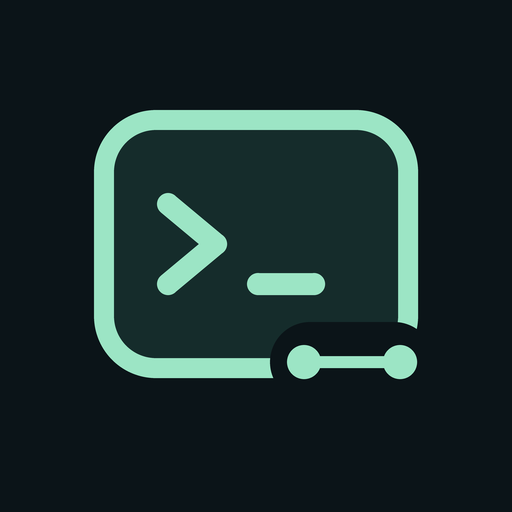

# CodeRelay — suas sessões de código, onde você estiver

Aplicativo Flutter para Android e iOS. Conecta a várias máquinas por Tailscale,
lista e retoma sessões antigas sem exigir que elas já tenham sido abertas no
celular. Repositório: `lucaswilliameufrasio/remote-code`. O pacote Dart interno
continua `remote_dev` por compatibilidade; o app se chama **CodeRelay**, com
application ID Android e bundle ID iOS `com.lucaswilliameufrasio.remotecode`.

O nome combina código com a ideia de retransmitir e retomar o trabalho entre
computador e celular. A logo une um terminal e dois pontos conectados, em
verde-menta sobre fundo escuro. O mesmo símbolo aparece no onboarding, no
cabeçalho e nos ícones de Android/iOS. Fonte vetorial: `assets/brand/logo.svg`.
Para regenerar os PNGs, execute `scripts/generate_brand.py` em um ambiente Python
com Pillow e aplique `scripts/bootstrap.py`. O bootstrap copia os ícones já
versionados, sem precisar de Pillow. A troca visual não altera IDs, armazenamento
seguro, recuperação nem serviços do host; não é necessária migração de dados
da instalação Remote Code.

**Migração:** a troca de identificador instala um app diferente do antigo Remoto.
Dados do Keystore/Keychain não migram automaticamente. Mantenha a instalação antiga
até recadastrar e conferir as máquinas no novo app; não compartilhe senhas ou a
frase de recuperação em arquivos de configuração. Chaves internas de persistência
e derivação de recuperação foram preservadas, não redefinidas pela renomeação.

## O que está implementado

- Cadastro/edição de várias máquinas e teste de saúde/versão.
- HTTP Basic Auth, senha e dados locais no Android Keystore/iOS Keychain.
- API HTTP OpenCode v2: sessões globais paginadas com busca por cursor opaco.
- Listagem por diretório, cadastro de caminhos e abertura direta pelo ID.
- Explorador remoto somente leitura pelo menu **Arquivos do projeto** do chat:
  navegação por subpastas, busca até 100 resultados e prévia UTF-8 até 256 KiB.
  **Inserir caminho no rascunho** inclui somente a referência textual ao caminho,
  sem anexar o conteúdo nem enviar uma mensagem automaticamente. O seletor de
  pastas também oferece **Explorar** para escolher uma subpasta conhecida.
  Exige a extensão [File Browser](host/file-browser/README.md) configurada no host;
  ela aplica raízes autorizadas e recusa links simbólicos. Sem a extensão, o
  explorador falha fechado, sem voltar à API filesystem irrestrita do OpenCode.
  No seletor de pasta, **Carregar raízes autorizadas do host** descobre as raízes
  configuradas sem precisar memorizar seus caminhos.
- **Ver alterações** mostra arquivos, totais de adições/remoções e patches
  coloridos do turno mais recente da sessão, não o diff completo do Git.
- Pareamento assistido por código temporário: depois de informar a URL HTTPS,
  confira o destino, resgate um código de uso único e salve a máquina para persistir
  a credencial. Também aceita QR pela câmera, validado contra a mesma origem HTTPS;
  ler o QR apenas preenche o código, sem conectar automaticamente. A senha e a
  entrada manual continuam disponíveis quando a câmera não puder ser usada.
- Ao iniciar uma sessão, seletor de pasta com busca por nome/caminho e sugestões
  de projetos, sessões recentes e diretórios salvos da máquina; também aceita
  digitar outro caminho completo.
- Tela **Trabalho** combina atalhos locais com as 10 sessões globais mais
  recentes de cada máquina; atualiza ao reabrir a aba ou puxar para atualizar.
  O botão **Carregar mais 10 sessões** busca a próxima página da máquina indicada
  sem repetir sessões; desaparece quando não há mais páginas.
  A busca por título consulta todas as sessões no servidor, não apenas as dez
  carregadas. A seta de atualização do topo também recarrega as sessões.
- Aba de projetos organizada por máquina, usando projeto/worktree do OpenCode e
  diretório como alternativa; tocar abre as sessões filtradas do diretório.
- Inbox global de perguntas e permissões pendentes. A verificação é sob demanda,
  sem polling em segundo plano; consulta localizações conhecidas via API v2 e
  considera até 100 sessões recentes por máquina, 100 atalhos e 20 sessões ativas
  por atualização. Diretórios desconhecidos podem não aparecer até serem
  descobertos pelo servidor ou cadastrados no app.
- Chat com 30 mensagens recentes no primeiro carregamento e histórico paginado por
  cursor ao rolar para mensagens antigas; atualizações recentes preservam o histórico
  carregado, com Markdown e ações de ferramenta recolhidas.
- Botão **Anexar arquivo** no chat para PNG/JPEG/GIF/WebP, PDF e texto UTF-8.
  Revise os nomes e remova arquivos antes de enviar. Até 4 arquivos e **5 MiB no
  total por mensagem**; imagens e PDF exigem um modelo que informe suporte ao
  formato. A seleção não é restaurada ao sair da tela; o rascunho persistido continua
  sendo apenas texto. Áudio e vídeo não são enviados como anexos nesta versão.
- Busca de agentes e modelos; mensagens podem ser enfileiradas durante uma execução.
  Editar uma mensagem de texto pendente substitui o original e coloca a versão nova
  no fim, pois a API OpenCode v2 não edita texto em posição. Mensagens com anexos ou
  referências não compatíveis ficam protegidas contra substituição.
- MCPs com status e ações de conexão, skills disponíveis e ativação na sessão.
  Conectar/desconectar MCPs altera o estado em runtime até reiniciar o OpenCode.
- Aprovação de permissões uma vez, sempre ou negar; perguntas pendentes em destaque,
  com respostas por opção ou texto próprio e navegação entre perguntas.
  Permissões persistentes mostram ação, projeto e padrões antes da confirmação;
  respostas duplicadas são bloqueadas enquanto o envio está em andamento.
  O horário de primeira detecção neste celular é identificado como tal, sem
  inventar um horário de criação que o servidor não informa.
- Ditado curto no compositor: a transcrição fica editável no rascunho e não é
  enviada até tocar no botão normal de envio. O serviço de reconhecimento do
  dispositivo pode usar rede; o CodeRelay não envia a gravação ao OpenCode.
- Até 100 atalhos recentes de sessões, identificados por máquina + ID, com
  diretório e rascunho persistentes.
- Onboarding inicial com bloqueio local opcional por senha, biometria do
  dispositivo ou ambos; recuperação da senha por frase BIP-39 de 12 palavras.
- Atualização a cada 3 segundos durante execução e 10 segundos em repouso; reconexão
  com espera de até 30 segundos. Ao retornar ao app, recarrega somente as mensagens
  recentes e preserva as páginas antigas já abertas.
  O chat informa o horário da última atualização bem-sucedida e distingue acesso
  negado de sessão/API indisponível; isso não detecta sozinho se o PC está desligado.
- Envio sem confirmação: persiste um marcador no armazenamento seguro antes do
  POST e usa o ID do prompt para consultar histórico/fila, inclusive ao reabrir a
  sessão. Enquanto não houver confirmação, bloqueia outro envio. Não usa igualdade
  de texto como prova nem repete prompts automaticamente. Depois de conferir o
  histórico, o usuário pode liberar um novo envio explicitamente, aceitando o risco
  de duplicação. Isso não é garantia de execução exatamente uma vez.
- Instaladores de serviço Linux/systemd e macOS/LaunchAgent.
- Diagnóstico de conexão sob demanda no cadastro da máquina: conexão, TLS,
  autenticação, compatibilidade e extensão de arquivos. Relatório copiável sem
  URL, credenciais, caminhos ou conteúdo das sessões; mostra versões do app/servidor.
- Avisos no chat aberto para novas pendências e transição de execução para repouso.
  Não são push: não monitoram outras sessões nem funcionam com o app fechado.
  Repouso não comprova sucesso; confira a resposta e eventuais erros.
- Workflow GitHub Actions para testes/cobertura, APK debug e artefatos Android/iOS
  release explicitamente sem assinatura, sem publicação nas lojas.

## Estado da entrega

Migração para a API OpenCode v2 implementada com testes de contrato HTTP e
integração no simulador contra um servidor v2 real isolado, incluindo HTTPS,
explorador restrito, reconciliação e snapshots. Aceitação autenticada no endpoint
remoto e hardware físico permanece separada; consulte `VALIDACAO.md`.

O CodeRelay suporta **OpenCode v2 e Claude Code**, com contratos separados.
Claude Code exige o [adaptador opcional no host](host/claude-code/README.md),
configurado com senha própria e raízes autorizadas. O app lista histórico local,
cria sessões e continua sessões antigas em um fork confirmado, com texto, seleção
de modelo, aprovações por uso, perguntas e interrupção. Não oferece paridade com
os recursos OpenCode: anexos, fila, pareamento, arquivos/diff e gestão de MCP/skills
continuam específicos do OpenCode. As credenciais Anthropic permanecem no host.

No cadastro ou edição da máquina, **Como configurar no computador** abre um guia
offline específico para o agente selecionado, com comandos copiáveis, configuração
privada do Tailscale Serve, credenciais corretas, diagnóstico e encerramento seguro.
O guia não executa comandos nem copia as senhas informadas no formulário.

Os diretórios nativos `android/` e `ios/` são gerados por `scripts/bootstrap.py`
usando teu SDK Flutter, evitando um scaffold nativo manual incompleto. O script
preserva `lib/` e `pubspec.yaml` e configura os projetos recém-gerados.

## 1. Preparar cada máquina

Instale OpenCode e Tailscale. Faça login no Tailscale e configure os provedores
do OpenCode com o **mesmo usuário que já usava as sessões antigas**.

### Iniciar manualmente com Tailscale

Para este app Flutter, use `opencode serve`: ele disponibiliza a API HTTP sem a
interface web. `opencode web` é para abrir a interface do OpenCode no navegador e
não é necessário para conectar este app.

O app usa a API HTTP v2 do servidor. Servidores que oferecem somente a API
legacy v1 não são compatíveis.

Configure `OPENCODE_SERVER_PASSWORD` no ambiente do servidor usando o gerenciador
de segredos disponível para você. Não coloque a senha em argumentos de comandos,
no histórico do shell ou em arquivos versionados. O usuário HTTP padrão do OpenCode
é `opencode`. Execute o servidor com o mesmo usuário do sistema que possui as
sessões antigas.

#### Prompt oculto para uso temporário (Bash/Zsh)

Digite a senha somente no prompt oculto. O comando e a senha não ficam no histórico
do shell; mantenha este terminal aberto enquanto estiver usando o servidor:

```bash
printf 'Senha do servidor: '
read -s OPENCODE_SERVER_PASSWORD
printf '\n'
export OPENCODE_SERVER_PASSWORD
opencode serve --hostname 127.0.0.1 --port 4096
unset OPENCODE_SERVER_PASSWORD
```

Em outro terminal da workstation, publique o serviço somente pela tailnet:

```bash
tailscale serve --bg http://127.0.0.1:4096
tailscale serve status
```

O `tailscale serve` cria o endpoint HTTPS da máquina dentro da tailnet. No celular,
conecte o Tailscale e cadastre no app a URL HTTPS exibida por `tailscale serve
status`, usuário `opencode` e a senha definida acima ou fornecida pelo gerenciador
de segredos do ambiente. O servidor fica ligado apenas ao loopback; não use Funnel
nem exponha a porta 4096
publicamente. `opencode serve` permanece em primeiro plano:
mantenha o terminal do servidor ativo ou use `tmux` se precisar deixá-lo rodando
ao sair.

### Linux, incluindo CachyOS

```bash
bash host/install-linux.sh
sudo loginctl enable-linger "$USER"
tailscale serve --bg http://127.0.0.1:4096
tailscale serve status
systemctl --user status remote-dev-opencode.service
```

O instalador pede uma senha, cria um arquivo privado de ambiente e usa o
executável instalado no teu PATH. `enable-linger` permite iniciar o serviço de
usuário no boot, antes de abrir o terminal ou fazer login. Confira se `tailscaled`
também está habilitado no boot. Não execute o instalador como root.

### macOS

```bash
python3 host/install-macos.py
tailscale serve --bg http://127.0.0.1:4096
tailscale serve status
```

O LaunchAgent inicia ao fazer login. Não promete disponibilidade antes do login,
inclusive após reboot com FileVault. O computador deve estar acordado e online.
Um serviço de sistema antes do login requer configuração separada de usuário e
acesso aos dados; não é instalado por este pacote.

Se a porta 4096 já estiver em uso, pare/ajuste o servidor anterior ou altere porta
no serviço e no Tailscale Serve. O pacote não encerra processos existentes.

### Usar também no terminal

```bash
  opencode attach '<URL_EXIBIDA_PELO_TAILSCALE_SERVE>' \
  --dir '<CAMINHO_DO_PROJETO>' --session '<ID_DA_SESSAO>'
```

Anexe o TUI ao serviço persistente para terminal e celular operarem no mesmo
servidor. Execute o comando em um ambiente que disponibilize as credenciais do
servidor pelo mecanismo seguro escolhido; nunca inclua a senha no comando ou no
histórico do shell. Não precisa manter uma janela de terminal aberta para o
agente rodar.

## 2. Preparar o Flutter

Use Flutter estável 3.35 ou superior, Python 3 e Android SDK/JDK para Android.
Para iOS use teu Mac com Xcode, CocoaPods e assinatura Apple configurada.

Para testar um servidor OpenCode local no iOS Simulator, o build de depuração
aceita `ALLOW_LOCAL_SERVER_HTTP=true` e `USE_LOCAL_OPENCODE_SERVER=true`. O
segredo precisa chegar ao processo do simulador pela variável
`REMOTE_OPENCODE_SERVER_PASSWORD`; o app salva esse perfil apenas no Keychain do
simulador. Não passe senha em `--dart-define` nem habilite essa opção em release.
O servidor de teste deve continuar limitado a `127.0.0.1`.

No iOS Simulator, o app lê essa variável por um canal nativo disponível apenas
em builds `DEBUG`; o opt-in de preview também precisa estar ativo. A senha não é
incluída no binário nem nos argumentos de build e, após a leitura, é persistida
no Keychain do simulador.

```bash
python3 scripts/bootstrap.py
dart format lib test integration_test test_driver
flutter analyze --no-fatal-infos
flutter test
make test-ios-simulator
flutter run
```

`make test-ios-simulator` executa o onboarding em um iOS Simulator inicializado.

O gate completo é `make setup-claude` (uma vez, Python 3.11+) e depois
`make precommit` (validação, lint Android e builds Android/iOS). Inclui os testes HTTP/SQLite do adaptador Claude e
o SDK/CLI oficial contra um modelo local determinístico, além da suíte OpenCode.
`make test-claude-local-app DEVICE=<simulator-id>` valida a jornada Claude no
simulador por HTTPS, sem usar conta ou credenciais reais da Anthropic.

`make test-local-app DEVICE=<simulator-id>` executa o cliente e as telas de produção
contra um OpenCode v2 real e isolado, com extensão de arquivos, projeto Git e HTTPS
locais. Requer Python 3, OpenSSL, OpenCode e um iOS Simulator inicializado. O runner
gera uma CA temporária confiada somente pelo cliente do teste, sem desabilitar TLS
ou alterar Keychain/ATS. Verifica autenticação, recusas de filesystem, navegação,
reconciliação de ACK perdido sem reenvio, anexo e diff de snapshots. O provedor de
modelo é uma fixture OpenAI-compatible local determinística: não há inferência
externa, credenciais reais ou cobrança. Os processos e dados temporários são
encerrados/removidos ao final. Não valida câmera, ditado ou o endpoint remoto.

Comandos úteis: `make help`, `make run DEVICE=<id>`, `make test-ci` (cobertura em
`coverage/lcov.info`), `make lint-native-android`, `make android-signing-report`.

Para gerar o APK de desenvolvimento ou validar compilação release:

```bash
make apk-debug
make apk-unsigned
make aab-unsigned
```

Artefatos APK: `build/app/outputs/flutter-apk/app-debug.apk` e
`build/app/outputs/flutter-apk/app-release.apk`. AAB:
`build/app/outputs/bundle/release/app-release.aab`. **Os artefatos unsigned não
são instaláveis/publicáveis sem assinatura.** Release nunca usa a chave debug.

Para builds assinados, disponibilize pelo seu gerenciador de segredos as quatro
variáveis `CODERELAY_ANDROID_KEYSTORE_PATH` (caminho absoluto do keystore),
`CODERELAY_ANDROID_STORE_PASSWORD`, `CODERELAY_ANDROID_KEY_ALIAS` e
`CODERELAY_ANDROID_KEY_PASSWORD`. Não escreva senhas em comandos, arquivos
versionados ou histórico do shell. Depois execute `make apk-release` (alias
`make build-apk`) ou `make build-aab`. Sem configuração completa, esses comandos
falham antes de compilar. Mantenha backup privado da chave para futuras atualizações.
Uma instalação antiga assinada com debug não aceita atualização com outra chave;
não remova o app antigo sem conferir como recadastrar máquinas e preservar acesso.

No iOS:

```bash
open ios/Runner.xcworkspace
make build-ipa
```

Configure teu Development Team e provisionamento no Xcode; preserve o bundle ID
existente para atualizar a mesma instalação.
Um `Runner.app` sem assinatura do CI não é instalável em um iPhone comum;
use assinatura local/TestFlight para isso.

Decisões, limites e roteiro de aceitação: [distribuição e diagnóstico](docs/distribution-and-diagnostics.md).

## 3. Cadastrar máquinas no celular

1. Instale/ative o Tailscale no Android/iPhone, na mesma tailnet.
2. Toque **Máquina** e informe nome, URL HTTPS emitida pelo Tailscale Serve,
   usuário `opencode` e a senha.
3. Cadastre opcionalmente os diretórios remotos (caminhos do PC, não do celular).
4. Teste conexão, salve e abra a máquina.
5. Use **Todas as sessões**, um diretório, ou o ícone de chave para abrir pelo ID.

Serve mantém o acesso dentro da tailnet e usa certificado HTTPS confiável.
Não habilite Funnel para este caso. Respeite as ACLs/grants da tua tailnet.
O app não gerencia o login/VPN Tailscale nem descobre dispositivos pela API
administrativa. Conecta às URLs cadastradas usando a VPN do sistema.

HTTP direto em IP `100.64.0.0/10`, IPv6 Tailscale ou MagicDNS é opcional:

```bash
python3 scripts/bootstrap.py --allow-http
flutter run --dart-define=ALLOW_TAILNET_HTTP=true
flutter build apk --debug --dart-define=ALLOW_TAILNET_HTTP=true
```

Esse opt-in relaxa ATS/cleartext no projeto nativo. O app ainda limita HTTP aos
formatos de endereço da tailnet, mas hostname curto não comprova que a rota
está passando pela VPN. Use HTTPS em operação normal. Nunca ignora certificados.

## 4. Recuperar sessões que nunca apareceram no celular

**A sessão mora na máquina, não no aplicativo Android.** A lista global consulta
o servidor e pode encontrar diretórios nunca cadastrados no celular. Abertura
pelo ID não cria uma nova sessão: carrega a sessão existente e seu diretório
remoto.

Se não encontrar uma sessão:

```bash
cd /caminho/do/projeto
opencode session list --format json
opencode db path
```

Confira usuário, HOME/XDG_DATA_HOME, instalação e caminho do banco de dados do
processo usado anteriormente. Um servidor de outro usuário não terá aquele
histórico. Sessões num banco antigo não são recuperadas apenas sabendo o ID.

Para migrar entre instalações/usuários, faça uma exportação explícita na origem
e importação no destino, sem sobrescrever nem apagar o banco original:

```bash
opencode export ses_ID > session.json
opencode import session.json
```

Confira o ID retornado após importar e abra esse ID no app. O diretório do projeto
e os arquivos precisam continuar acessíveis na máquina de destino. A importação
é uma operação no host; o app não copia bancos SQLite nem arquivos do projeto.

O filtro por diretório consulta até 500 sessões. Para continuar além desse limite,
use a lista global paginada. A API usa cursores opacos; o app não tenta inferir
posição por timestamp. O chat abre as 30 mensagens mais recentes e permite
carregar páginas anteriores ao rolar o histórico.

## O que reboot consegue restaurar

O serviço volta, o app reconecta, carrega o histórico persistido e permite enviar
um novo comando na mesma sessão. Várias sessões ficam disponíveis para retomada.
Trocar de tela/app não aborta o agente que continua rodando no PC.

Reboot interrompe processos, ferramentas e requisições de modelo em andamento.
O app **não retoma uma execução automaticamente** nem repete prompts que possam
ter sido recebidos antes de uma queda de conexão. Revise o histórico/diff e envie
um comando de continuação. Ele não liga um PC desligado nem evita suspensão.

## Compatibilidade e limites

Esta versão usa a API HTTP **v2** (`/api/session` e recursos relacionados), não
os endpoints legacy v1. A documentação do OpenCode ainda classifica a API HTTP
v2 como experimental e seus contratos podem evoluir. Mantenha o servidor
atualizado; servidores que só oferecem a API v1 não são compatíveis.

Permissões e formulários pendentes são consultados por sessão. O app não aprova
permissões automaticamente.

O explorador usa somente o RPC `remote-code-files-v1` da extensão opcional do host.
As raízes são escolhidas pelo operador, com negação por padrão se não configuradas;
aberturas por descritores e `O_NOFOLLOW` recusam traversal e links simbólicos.
Instalação e limites em [host/file-browser/README.md](host/file-browser/README.md).
**Isso não é sandbox das ferramentas do agente** e não desativa os endpoints
filesystem nativos para outros clientes. A lista de diretórios salvos continua
sendo um atalho, não a fonte de autorização. Prévia de diff
limitada a 128 Ki caracteres/2000 linhas, com aviso quando incompleta.

Para parear, gere um código na **mesma instância OpenCode** que atende a URL
cadastrada usando `opencode api post /api/pair` no computador confiável. Informe
apenas o campo `code`, não o token ou uma URL de outro host. O resgate exige HTTPS,
não segue redirects nem repete códigos automaticamente e confirma a versão v2.
Não compartilhe códigos/tokens nem salve sua saída no repositório. Se o endpoint
não estiver disponível, continue com a senha manual. Pareamento real pela tailnet
ainda requer validação; nenhum código real foi gerado/resgatado nos testes.
O leitor de QR processa os quadros localmente e não envia imagens. QR de outra
origem, HTTP, com credenciais embutidas ou parâmetros extras é recusado. O teste
automatizado injeta detecções sintéticas: não substitui teste de câmera física.

## Proteção local do aplicativo

Na primeira abertura, escolha senha, biometria, as duas opções ou continue sem
bloqueio. Quando habilitada, a tela de bloqueio aparece ao abrir o app e ao
retornar do segundo plano. A biometria usa Face ID/Touch ID ou a autenticação do
dispositivo como alternativa. No Android, o projeto usa o prompt biométrico do
sistema.

A senha tem no mínimo oito caracteres. O app guarda somente um verificador com
salt, derivado com PBKDF2-HMAC-SHA-256; a senha não é enviada ao servidor. Ao
configurá-la, o app gera uma frase BIP-39 de 12 palavras, mostra-a uma vez e pede
que seja digitada novamente. Guarde-a em um gerenciador de senhas confiável ou
em outro local seguro e privado. Ela permite redefinir a senha local; não é
possível recuperar a frase pelo app.

Essa senha é uma barreira adicional de interface, não uma chave de criptografia
do cofre local. Credenciais e dados locais continuam no Keychain/Keystore do
sistema operacional, e a proteção do dispositivo continua necessária. O modelo
de autenticação e os contratos da API OpenCode v2 não mudam.

Sem terminal SSH interativo, editor completo, notificações push,
VPN embutida ou sincronização de credenciais entre celulares nesta entrega.
Polling é suspenso em segundo plano; iOS não garante execução contínua do app.
Histórico é carregado do servidor ao abrir; não há cópia offline do chat.

Credenciais locais não são exportadas. Logs dos serviços podem conter conteúdo
do trabalho. Guarde os arquivos privados do host e aplique as regras de rede da
tailnet. O app não expõe porta pública e o OpenCode fica ligado apenas a loopback.

## Estrutura

```text
lib/core/         cliente HTTP, modelos e armazenamento seguro
lib/features/     máquinas, sessões, chat e solicitações do agente
host/             inicialização persistente Linux/macOS
scripts/          geração dos projetos nativos e verificações locais
test/             contratos HTTP e retomada após reiniciar o app
.github/workflows/flutter.yml
```

## Fontes usadas na implementação

- https://opencode.ai/v2/docs/api/
- https://opencode.ai/v2/docs/build/client/
- https://opencode.ai/v2/docs/cli/
- https://github.com/anomalyco/opencode/blob/dev/packages/opencode/src/session/session.ts
- https://tailscale.com/docs/reference/tailscale-cli/serve
- https://tailscale.com/docs/use-cases/application-testing/share-local-dev-server-with-team
